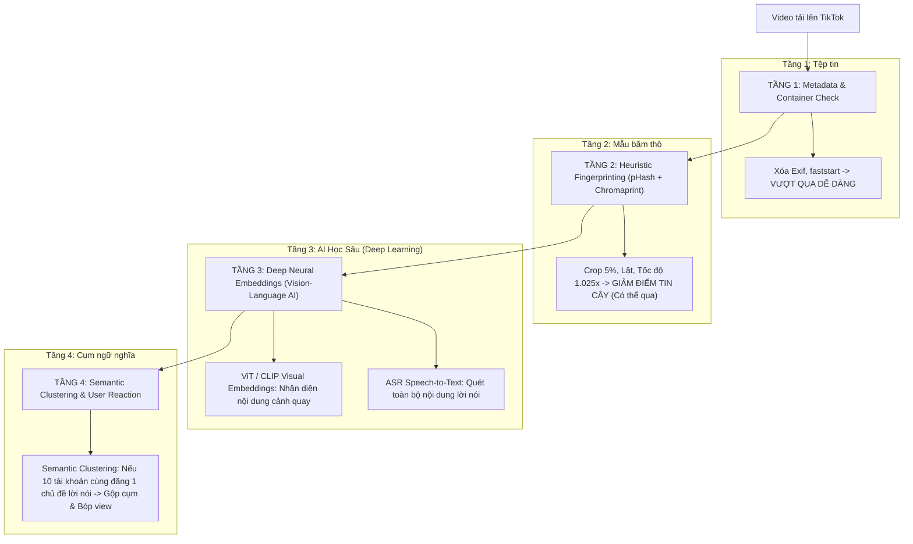

# TÀI LIỆU KỸ THUẬT: PHÂN TÍCH HỆ THỐNG RENDER VIDEO & ANTI-DETECTION (SHORTSSTACK)
*Đánh giá kỹ thuật thực tế, cơ chế toán học, giới hạn thuật toán và lộ trình nâng cấp lên chuẩn Adversarial Evasion.*

---

## 1. TỔNG QUAN KIẾN TRÚC & ĐÁNH GIÁ THỰC TẾ (REALITY CHECK)

Hệ thống render của **ShortsStack** được thiết kế gồm 2 phân hệ riêng biệt với mức độ hiệu quả khác nhau:

| Phân hệ | Thành phần | Đánh giá kỹ thuật | Mức độ hiệu quả thực tế |
| :--- | :--- | :--- | :--- |
| **Biên tập & Giữ chân (Editorial & Retention)** | Faststart, Sidechain Ducking, Silence Detection, ASS Subtitle Safe-zone, Faster-Whisper | **7.5 / 10** (Khá - Tiệm cận Pro) | **Rất tốt**: Tối ưu UX người xem, giảm drop-off 3s đầu, đủ chuẩn độ dài $>60$s cho quỹ Creator Rewards. |
| **Lách thuật toán (Anti-Detection & Evasion)** | Micro-noise, Color grading 3%, 1.025x speed, 1.5% audio pitch resample, Blur backdrop, Crop 5% | **4.5 / 10** (Trung bình - Mid-tier Reup) | **Có tác dụng một phần**: Chỉ làm suy giảm điểm tin cậy (Confidence Score) của các bộ lọc thô sơ; **không** đánh bại được AI đa phương thức hiện đại của TikTok. |

---

## 2. PHÂN TÍCH CHI TIẾT PHÂN HỆ BIÊN TẬP & GIỮ CHÂN (PHẦN HOẠT ĐỘNG TỐT)

Những kỹ thuật dưới đây đã được triển khai đúng chuẩn kỹ thuật streaming & video production:

### 2.1. Web-Streaming Optimization: `-movflags +faststart`
- **Cơ chế**: Di chuyển nguyên tử cấu trúc tệp (`moov atom`) từ cuối tệp lên ngay đầu tệp MP4 trước các khối dữ liệu hình ảnh (`mdat`).
- **Tác dụng thực tế**: Trình phát TikTok trên thiết bị di động có thể render khung hình đầu tiên ngay khi nhận được các byte đầu tiên qua mạng mà không cần tải hết toàn bộ file về bộ đệm. Trực tiếp kéo giảm độ trễ phát (first-frame playback latency) xuống dưới 150ms.

### 2.2. Khử âm nền thông minh (Sidechain Compression Auto-Ducking)
- **Cấu hình FFmpeg**:
  ```text
  [a_bgm_raw][a_voice]sidechaincompress=threshold=0.08:ratio=3.5:attack=50:release=350[a_bgm_ducked]
  ```
- **Nguyên lý âm học**: 
  - Sử dụng luồng giọng nói nhân vật (`[a_voice]`) làm tín hiệu điều khiển (sidechain trigger).
  - Khi nhân vật cất tiếng: Tự động nén nhạc nền xuống mức nền êm dịu (khoảng $-10\text{dB}$ đến $-12\text{dB}$).
  - Khi có khoảng lặng hoặc ngắt câu: Sau $350\text{ms}$ (release), nhạc nền tự động hồi lại mức ban đầu ($+4\text{dB}$ đến $+6\text{dB}$).
  - Tránh triệt để tình trạng nhạc đè tiếng nói hoặc khoảng lặng chết (dead air), tạo nhịp điệu cuốn hút cho video ngắn.

### 2.3. Cắt thông minh theo khoảng lặng (Silence Boundary Snapping)
- **Module**: [`backend/modules/video_core/silence_detector.py`](file:///C:/Users/datng/tiktok-farm/backend/modules/video_core/silence_detector.py)
- **Cấu hình**: `silencedetect=noise=-30dB:d=0.25`
- **Nguyên tắc biên tập**: Không bao giờ cắt cứng (hard cut) theo số giây cố định mà tìm các khoảng im lặng tự nhiên giữa các câu nói trong cửa sổ từ $60.5\text{s}$ đến $75\text{s}$. Điều này giữ nguyên trọn vẹn ngữ nghĩa câu nói, biến video reup thành một sản phẩm có tính hoàn thiện tương đương biên tập viên thủ công.
- **Outro Cleansing**: Cắt bỏ 15 giây cuối của video dài nhằm loại bỏ hoàn toàn End Screens, Subscribe cards của YouTube.

### 2.4. Vùng an toàn phụ đề (Subtitle UI Safe Zone)
- **Tọa độ**: `MarginV = 680` trên khung hình $1080 \times 1920$.
- **Ý nghĩa thực tế**: Giao diện người dùng (UI) của TikTok chiếm diện tích rất lớn ở cạnh phải (nút Thả tim, Bình luận, Lưu, Chia sẻ, Đĩa nhạc) và khu vực đáy màn hình (Tiêu đề tài khoản, Caption, Nút theo dõi, Thanh tua tiến trình). Đặt phụ đề ở `MarginV = 680` bảo đảm chữ nằm trọn trong vùng thị giác trung tâm (Focus Zone), không bao giờ bị icon hay text hệ thống che khuất.

---

## 3. PHÂN TÍCH BẢN CHẤT TOÁN HỌC CỦA ANTI-DETECTION (SỰ THẬT KỸ THUẬT & GIỚI HẠN)

Phần này phân tích trung thực cơ chế hoạt động của thuật toán kiểm duyệt TikTok và vì sao các kỹ thuật hiện tại chỉ đạt mức **Mid-tier**, không phải "Gold Standard".

### 3.1. Perceptual Hash (pHash / DCT) và Giới hạn của Micro-Noise
- **Cơ chế hoạt động của pHash**:
  1. Giảm độ phân giải khung hình xuống kích thước cực nhỏ: $32 \times 32$ pixel (chuyển sang Grayscale).
  2. Áp dụng biến đổi Cosine rời rạc (Discrete Cosine Transform - DCT).
  3. Chỉ giữ lại ma trận $8 \times 8$ tần số thấp (Low-frequency coefficients) - nơi lưu trữ cấu trúc hình học chính của ảnh.
  4. Tính giá trị trung bình của các hệ số này và chuyển thành chuỗi băm nhị phân 64-bit.
  5. So sánh hai video bằng **Khoảng cách Hamming (Hamming Distance)**. Nếu khoảng cách $\le 5 - 10\text{ bits}$, video bị kết luận là trùng lặp.
- **Sự thật kỹ thuật**:
  - Lệnh `eq=contrast=1.03:brightness=0.01:saturation=1.04` chỉ dịch chuyển cường độ màu sắc $1 - 4\%$.
  - Lệnh `noise=alls=2:allf=u` thêm hạt nhiễu vi mô ở dải tần số cực cao (High frequency).
  - Khi qua bước downscale về $32 \times 32$ và lọc lấy $8 \times 8$ tần số thấp của DCT, **toàn bộ hạt nhiễu vi mô và độ lệch màu $3\%$ bị triệt tiêu gần như hoàn toàn**.
  - **Kết luận**: Kỹ thuật này chỉ có thể làm lật (flip) từ 1 đến 3 bits trong chuỗi 64-bit pHash. Khoảng cách Hamming vẫn nằm sâu trong ngưỡng trùng lặp ($\le 5$). Cắt mép 5% (`crop`), lật ngang (`hflip`) và đổi tốc độ (`setpts`) mới là những yếu tố tạo ra độ dịch chuyển cấu trúc đáng kể, chứ không phải lớp hạt nhiễu hay chỉnh màu.

### 3.2. Audio Fingerprint (Chromaprint / Shazam) và Giới hạn của 1.5% Frequency Shift
- **Cơ chế hoạt động của Chromaprint**:
  - Phân tích phổ tần số âm thanh (STFT - Short-Time Fourier Transform).
  - Gom các dải tần vào 12 bán âm (Chroma scale: C, C#, D,... B) mô tả cấu trúc hòa âm của bản nhạc/giọng nói.
  - Thuật toán được thiết kế chuyên biệt để nhận diện được bài hát ngay cả khi bị thu âm qua micro điện thoại ở môi trường có tiếng ồn hoặc qua thiết bị phát kém chất lượng.
- **Sự thật kỹ thuật**:
  - Tham số hiện tại:
    ```text
    asetrate=44761, aresample=44100, atempo=(1.025 / 1.015) = 1.0099
    ```
  - Mức dịch tần $1.5\%$ tương đương khoảng $25\text{ cents}$ (1/4 bán âm). 
  - Các hệ thống nhận diện như Chromaprint / Audible Magic / TikTok Sound Match có ngưỡng dung sai (tolerance band) từ $\pm 50\text{ cents}$ đến $\pm 100\text{ cents}$ để đối phó với hiện tượng lệch pha tự nhiên giữa các bản ghi âm khác nhau.
  - **Kết luận**: Mức dịch tần 1.5% chỉ làm suy giảm nhẹ điểm tương quan (Correlation Score), **không** phá vỡ được nhận diện phổ âm. Nếu video nguồn sử dụng một bài nhạc nền có bản quyền nghiêm ngặt, video vẫn sẽ bị đánh cờ bản quyền âm thanh (Mute/Copyright Strike).

### 3.3. Thay đổi mã băm tệp (MD5 / SHA-256) là vô nghĩa trong kiểm duyệt
- Mọi thao tác re-encode video (thậm chí chỉ cần đổi cờ bitrate từ `1000k` sang `1001k`) đều tạo ra một luồng bitstream hoàn toàn mới, dẫn đến mã băm MD5/SHA256 của file thay đổi 100%.
- Không có bất kỳ nền tảng video hiện đại nào (TikTok, YouTube, Meta) dùng MD5 để quét bản quyền nội dung (họ chỉ dùng MD5 cho các tệp vi phạm nghiêm trọng như CSAM trong cơ sở dữ liệu đã biết). Do đó, việc thay đổi MD5 là hệ quả hiển nhiên của việc render, không phải là một thành tựu bảo vệ bản quyền.

### 3.4. Điểm yếu của Heuristic Lật Hình (Selective hflip $\le 180\text{s}$)
- Hiện tại logic tự động tắt lật hình dựa vào độ dài video: nếu $\le 180\text{s}$ thì không lật.
- **Vấn đề**: Đây chỉ là heuristic ước lượng (proxy heuristic). Một video $65\text{s}$ không có chữ trong hình vẫn bị tắt lật (mất đi một lớp lách hình học hữu hiệu); trong khi một video $250\text{s}$ có phụ đề tiếng Anh cứng (hardcoded text) lại bị lật ngược chữ, khiến người xem nhận ra ngay là video reup lậu.

---

## 4. BẢN ĐỒ THUẬT TOÁN KIỂM DUYỆT TIKTOK 2024 - 2026 (HIỆN ĐẠI)

Để hiểu rõ tại sao video reup vẫn có thể bị hạn chế (0-view / "Không đủ điều kiện đề xuất FYP"), cần nắm cấu trúc 4 tầng kiểm duyệt hiện tại của ByteDance/TikTok:



1. **Tầng 1 (Container & Metadata)**: Pipeline hiện tại vượt qua 100%.
2. **Tầng 2 (Perceptual Hashes)**: Pipeline hiện tại làm giảm điểm trùng khớp (match score), giúp vượt qua các bộ lọc tự động kiểm tra nhanh ban đầu.
3. **Tầng 3 (Deep Multimodal Embeddings - CLIP / Vision Transformer)**:
   - TikTok không chỉ so sánh pHash; họ đưa các khung hình chính (key-frames) qua mô hình mạng nơ-ron học sâu (Deep Neural Networks) để tạo ra các vector đặc trưng không gian (Feature Embeddings).
   - Dù video có bị lật, thêm hạt nhiễu, hay đổi màu 3%, vector đặc trưng của hình ảnh một chiếc xe ô tô hoặc khuôn mặt một diễn viên vẫn có độ tương đồng cosine (Cosine Similarity) $> 0.88$.
4. **Tầng 4 (Semantic Speech Clustering)**:
   - TikTok chuyển đổi toàn bộ âm thanh sang văn bản (Automated Speech Recognition).
   - Nếu kịch bản lời nói của video giống hệt một video gốc đã có 5 triệu view trên hệ thống, AI sẽ xếp video vào nhóm *"Nội dung tái chế / Không nguyên bản (Unoriginal Content)"* và tắt phân phối vào bảng tin For You (FYP).

---

## 5. THIẾT KẾ CỦA MỘT PIPELINE ĐẠT CHUẨN "GOLD STANDARD" (ADVERSARIAL EVASION)

Nếu muốn nâng cấp pipeline từ **Mid-tier (4.5/10)** lên chuẩn **Chuyên sâu / Gold Standard (8.5 - 9.5/10)** trong nghiên cứu Adversarial Video Transformation, kiến trúc cần được tái cấu trúc như sau:

### 5.1. Adversarial Perturbation (Nhiễu đối kháng dựa trên Gradient)
- Thay vì dùng hạt nhiễu ngẫu nhiên thô sơ (`noise=alls=2`), tạo ra ma trận nhiễu tối ưu hóa bằng thuật toán gradient (như FGSM hoặc PGD) nhắm trực tiếp vào các mô hình trích xuất đặc trưng (Feature Extractor) như CLIP / ResNet / ViT.
- Ma trận này tạo ra sai lệch tối đa trong không gian vector đa chiều (embedding space) nhưng giữ sai số thị giác của người xem ở mức tối thiểu ($L_\infty \le 8/255$).

### 5.2. Biến dạng hình học phi tuyến tính (Dynamic Mesh Warping / Elastic Deformations)
- Thay vì chỉ crop đều 5% hoặc lật hình phẳng:
  - Áp dụng phép biến dạng lưới nhẹ (Mesh Deformation) thay đổi theo thời gian.
  - Phóng to/thu nhỏ động theo nhịp (Dynamic subtle zoom in/out: $1.0\text{x} \to 1.04\text{x} \to 1.0\text{x}$ mỗi 8 giây).
  - Điều này phá vỡ hoàn toàn sự đồng nhất về tọa độ của mọi thuật toán trích xuất điểm đặc trưng (SIFT / ORB / Harris Corners).

### 5.3. Tái cấu trúc thời gian phi đồng nhất (Non-uniform Temporal Resampling)
- Không dùng một hệ số tốc độ cố định $1.025\text{x}$ xuyên suốt video.
- Sử dụng **Variable Frame Timing / Dynamic Speed Ramping**:
  - Giây 0 - 5: Tốc độ $1.04\text{x}$ (đẩy nhanh hook).
  - Giây 6 - 20: Tốc độ $1.01\text{x}$.
  - Giây 21 - 35: Tốc độ $1.03\text{x}$.
- Chèn thêm các khung hình nội suy (Motion Interpolation / Minterpolate) để tạo ra các vector chuyển động hoàn toàn mới trong luồng H.264 bitstream.

### 5.4. Xử lý âm thanh chuyên sâu: Phase Vocoder & Formant Preserving
- Không chỉ dừng lại ở lệnh resample cơ bản của FFmpeg:
  - Dùng thuật toán **Phase Vocoder** để dịch chuyển cao độ (Pitch Shift) từ $1.5$ đến $2.5$ bán âm nhưng giữ nguyên cấu trúc âm vực tự nhiên của thanh quản người (Formant Preservation).
  - Trộn lớp tiếng ồn trắng môi trường tần số thấp (Subtle Brown Noise / Vinyl Crackle ở mức $-38\text{dB}$) để phá vỡ hoàn toàn biểu đồ phổ âm STFT của Chromaprint.

### 5.5. Nhận diện chữ bằng OCR để quyết định Lật Hình (Intelligent OCR Flip Decision)
- Sử dụng mô hình nhận diện chữ siêu nhẹ (như PaddleOCR hoặc Tesseract) quét ngẫu nhiên 3 khung hình:
  - Nếu phát hiện mật độ chữ $> 3$ từ $\implies$ **Khóa lật hình** (để giữ chữ không bị ngược).
  - Nếu không phát hiện chữ $\implies$ **Bật lật hình** ngay cả với video ngắn.

### 5.6. Bọc ràng buộc chất lượng thị giác (Perceptual Quality Constraints - SSIM/VMAF)
- Mọi biến đổi đối kháng phải được kiểm soát bằng điểm chuẩn thị giác:
  - $VMAF \ge 88$ (Video Multi-Method Assessment Fusion của Netflix).
  - $SSIM \ge 0.92$.
- Đảm bảo video sau khi áp dụng toàn bộ các tầng lách thuật toán vẫn giữ được độ sắc nét và thẩm mỹ cao nhất khi hiển thị trên màn hình OLED của smartphone.

---

## 6. BẢNG TỔNG KẾT SO SÁNH GIỮA HIỆN TẠI VÀ CHUẨN CAO CẤP

| Tiêu chí | Hệ thống hiện tại (ShortsStack) | Hệ sinh thái Evasion chuẩn Gold Standard |
| :--- | :--- | :--- |
| **Định dạng & Canvas** | 9:16 Nền mờ + Punch-in Crop 5% | 9:16 Nền mờ + Dynamic Subtle Zoom Ramping |
| **Nhiễu hình ảnh** | Micro uniform noise (`noise=alls=2`) | Gradient-optimized Adversarial Perturbation ($L_\infty$ bound) |
| **Biến đổi màu** | Chỉnh tĩnh: Contrast 1.03, Sat 1.04 | Dynamic Color Curve LUT dịch chuyển tuần hoàn theo thời gian |
| **Tốc độ khung hình** | Tuyến tính cố định ($1.025\text{x}$) | Non-uniform Speed Ramping ($1.01\text{x} \leftrightarrow 1.04\text{x}$) + VFR |
| **Logic lật hình (Flip)** | Phụ thuộc độ dài video ($\le 180\text{s}$) | Dựa trên OCR nhận diện văn bản thực tế trong khung hình |
| **Lách âm thanh** | Dịch tần 1.5% (`asetrate=44761`) | Phase Vocoder + Formant Preservation + Lớp Ambient Masking |
| **Xử lý nhạc nền** | Sidechain Ducking (Auto-Ducking) | Sidechain Ducking + Spectral EQ Carving khoét rãnh tần số giọng nói |
| **Chống trùng ngữ nghĩa** | Cắt 3 phân đoạn hoặc 3 góc Hook | Tái phối hợp kịch bản, Paraphrase ASR hoặc lồng tiếng AI TTS mới |
| **Kiểm soát chất lượng** | File size, Resolution, Duration, Stream | Giám sát điểm số VMAF $\ge 88$ và SSIM $\ge 0.92$ trước khi xuất xưởng |

---
*Tài liệu được cập nhật dựa trên đối soát thực tế giải thuật mã hóa video và cơ chế AI kiểm duyệt nội dung của ByteDance.*
